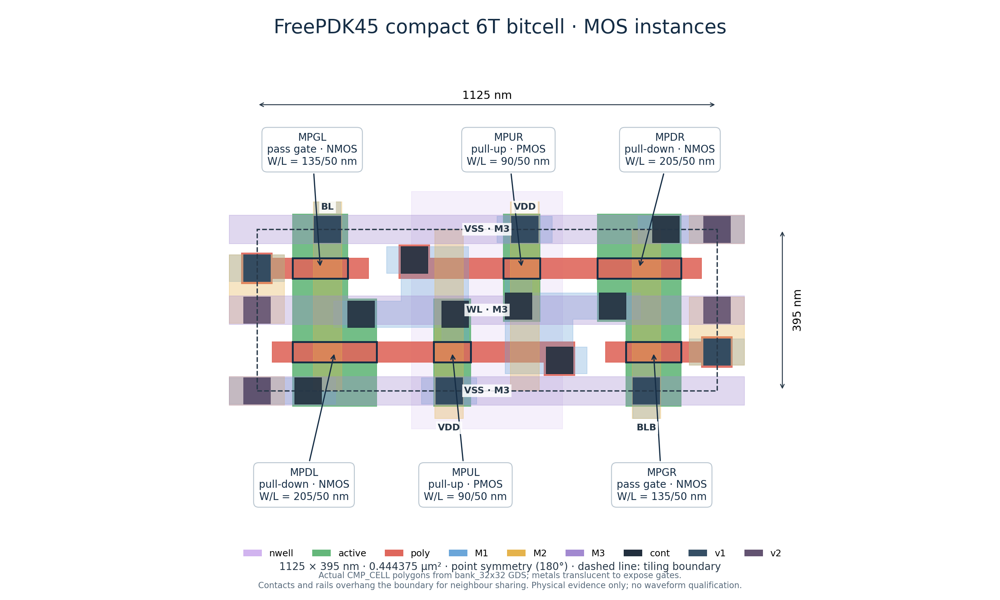
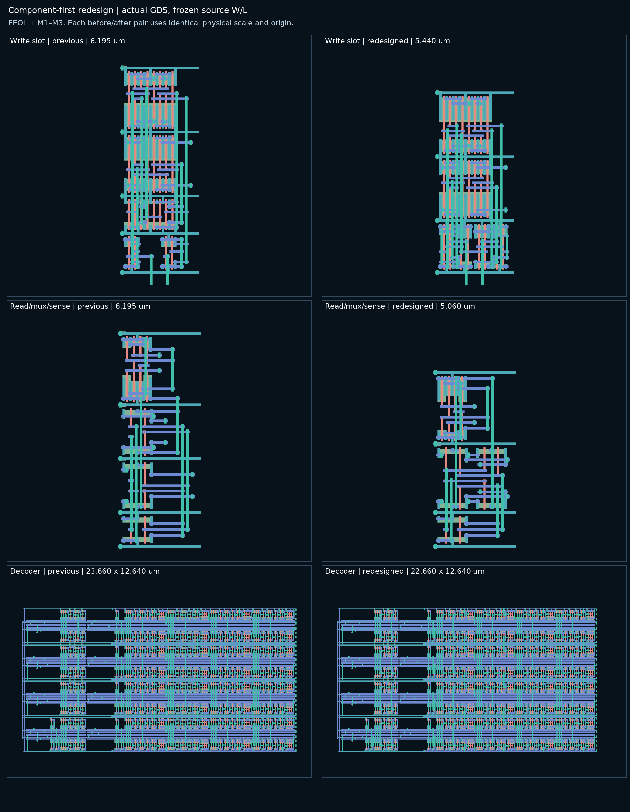
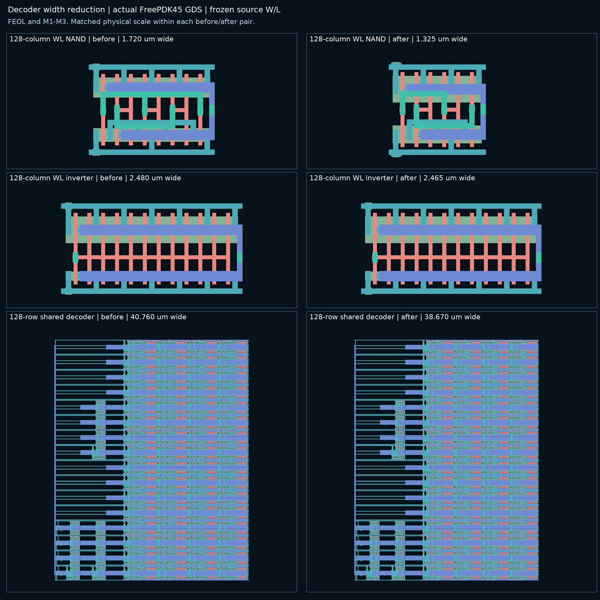
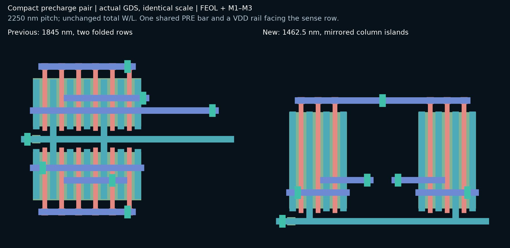

# Compact column-split SRAM layout — V2.2.8

`layout bank` uses the **1125 × 395 nm point-symmetric 6T cell** and splits
columns around one shared decoder. `--compact-cell --split-columns` are
accepted compatibility flags; both behaviors are always enabled. Add
`--with-controller` to include TIME_CONTROL, data registers, the replica
wordline driver and the output latch. Alternative bank pitches, unsplit and
row-split banks, and the beside-controller floorplan have been removed.

Source topology, models, total transistor W/L, sizing and timing tables, and
simulation RC profiles remain frozen. Selecting this physical default does
not establish waveform correctness or release qualification.

## Bitcell and array



The cell occupies **0.444 µm²**, 53.8% below the former 705 × 1365 nm
OpenRAM-pitch cell. Its PD/PG/PU widths are 205/135/90 nm, with 50 nm gate
length. The two halves rotate 180° about the cell centre and share a centre
n-well. Odd rows and columns mirror to share edge contacts and WL poly pads.

The placement reference is TSMC N28 MC2 cell
`S1BLVTS200W20_032_D156_V1D0_X1` (580 × 270 nm), inspected in
`ts1n28hpcplvtb512x32m4s_120a.gds`. FreePDK45 has no cut poly or butted
contacts, so the implementation follows its own official rules:

- **395 nm height:** 140 nm gate-row separation across shared contacts and
  between pass-gate and pull-down rows; storage contacts fit between gates.
- **1125 nm width:** two halves containing the 90 nm PU, 205 nm PD,
  140 nm N–P spacing, shared WL pads and required edge margins.
- **Cross-coupling:** a 75 nm poly pad extends beyond the opposite PMOS
  drain; M1 joins the gate pad, PMOS drain and NMOS storage contact.
- **Routing:** BL/BLB and VDD use M2; WL and edge VSS rails use M3.

A **460 nm well-strap row** separates every array edge from adjacent blocks.
The right half owns the single replica column and its RWL riser. Passive
replica cells tie inverter gates to VSS; the active replica ties QB to VDD.
The original dummy RWL loads are distributed across both column halves.
No source device or wordline driver is duplicated. At N × N organization,
each bitcell half-array has width/height **1.424**; a 128 × 128 bank has two
72 × 50.56 µm bitcell rectangles, before straps and periphery.

## Periphery and controller

Each **2250 nm column-pair slot** keeps adjacent columns and their 2:1 mux
together. Source decks must enable the column mux, which is already the
compiler default. Banks accept 8–512 rows in multiples of eight and 4–512
columns in multiples of four. Controller integration requires at least
16 rows. Physical 512 × 512 diagnostics require an explicit period because
automatic timing remains limited to 512 × 256.

| Block | Current implementation |
| --- | --- |
| Decoder | One source decoder and WL driver per logical row; each 3160 nm eight-row band holds two mirrored 1365 nm gate rows and seven M2 bus lines. Abutting implants and denser WL NAND folding reduce width; facing VSS taps share diffusion. |
| Write | Three rows: buffers with input/enable inverters, BL tristates, BLB tristates. Tiling height 5.440 µm at 32 rows and 7.965 µm at 64–512 rows. |
| Read/mux/sense | Select inverters, isolated BL/BLB transmission-gate islands sharing one row, folded sense amplifier; 5.060 µm total height. |
| Precharge | Two mirrored, isolated three-PMOS strips in one row; one 1080 nm finger per device, shared central PRE access; 1.4625 µm tiling height. The replica keeps the same U geometry. |
| Data registers | One frozen-source DFF per physical column, folded into pair slots below its own write buffer. Q tracks remain aligned with their buffer inputs. |
| TIME_CONTROL | Below the shared decoder, bottom-aligned with both register bands. Large controllers use unoccupied lower decoder rows before the planner widens the array gap. |



### Decoder and array spacing

The decoder leaf cells now join like implants at their horizontal boundaries.
Diffusion keeps 55 nm well enclosure, input/output via2 centres stay 152.5 nm
apart, and the 190 nm gate pitch is unchanged. This saves **15 nm per leaf**
relative to the preceding compact gates. The default controller gate geometry
is unchanged.

The wider WL NAND2 classes move both diffusion strips and body taps 22.5 nm
toward their supply rails. The extra room around the internal series-node
track permits **360/240 nm P/N fingers**, replacing 270/180 nm fingers.
At 128/256/512 columns, each source MOS uses **3/6/12 fingers instead of
4/8/16**. Total W/L, connectivity and models are preserved. Facing VSS taps
merge across eight-row band boundaries; isolated taps at those positions
would violate active and implant spacing.



The 128-column WL NAND shrinks from **1.720 to 1.325 µm** wide (23.0%).
The 128-row decoder placement width falls from **40.670 to 38.580 µm**;
the figure includes its additional rail/pin overhang. The bank's minimum
decoder-to-array clearance falls from **400 to 225 nm** on each side,
matching the opposite-well rule. The left half retains its supply-column
slot. Complete macros may need more room on the right for TIME_CONTROL:
the planner searches to the **100 nm routing grid** instead of stopping
within 1 µm, then reserves five routing tracks (0.5 µm) for escapes instead
of 1 µm. The minimum controller frame is 21.9 µm rather than 23.1 µm;
actual placement can require more. In controller-limited large macros,
decoder compaction can enlarge the remaining right-side corridor even as
total macro width decreases; the evidence records both clearances.

These changes affect junction and routing parasitics. Frozen transistor
widths and DRC/LVS do not establish waveform equivalence.

### Precharge

The precharge placement follows the repeated mirrored device groups inspected
in supplied `PLSRAM_FINAL_0427.gds`. Its `PLSRAM_FINAL` top is
57.13 × 88.50 µm with 16,384 bitcells. The reference SHA-256 is
`9904d847aaa9dd6ef622309a42d833cf2f6575846b16e1aa3d73ba347b314b95`;
inspection covered hierarchy and geometry, without TSMC DRC/LVS/extraction.



The one-row precharge is 20.7% shorter than its preceding 1845 nm form.
Its VDD rail abuts the sense row, removing a further 425 nm gap: the column
periphery is **807.5 nm shorter**. Total drawn precharge gate area stays
0.324 µm², while PMOS diffusion outside gates grows from 0.9882 to
1.0692 µm² (+8.2%). Refingering and routing change parasitics; geometric
symmetry does not establish balanced BL/BLB capacitance or read/write margins.

## Routing contract

| Connection | Layers |
| --- | --- |
| Devices, local array bitlines | M1/M2 |
| Array wordlines and local slot wiring | M3 |
| Peripheral bars, decoder outputs and predecode jogs | M4 |
| Local bitline drops and decoder address/enable trunks | M5 |
| Wordlines across the centre decoder, control/supply trunks | M6 |
| Integrated controller, feedback and macro input escapes | Through M10 |

The external-control bank uses M1–M6 only. Controller integration lifts
central bar crossings to M6 and feeds each half through its own supply
channel. Low-metal controller DFFs leave upper layers available for routing.
The placer reserves actual decoder polygons and SEL0/SEL1 via landings before
routing, and searches against the same band ceiling used by final placement.

Control and address inputs and SEL0/SEL1 reach macro edges on M10. OUT/OUT_B
leave right on M4; VDD/VSS trunks reach the top and bottom on M6. Per-column
DIN and sense outputs remain internal accesses. The output latch occupies
the replica slot's register position. `layout.json` records source instances,
fingers, terminals, bounds, split ownership, macro pins and provenance.

## Recorded physical results

The latest [decoder-width evidence](../../data/COMPACT_DECODER_WIDTH_V2_2_8.json)
binds these complete macros to their source, GDS, generator and tool/rule
hashes. Bounds include every source instance, controller, register, replica,
RWL driver, latch, route and macro pin.

| Complete macro | Bounds (µm) | Area (µm²) | Width saved (µm) | Calibre DRC / LVS | Distributed R+C+CC |
| --- | --- | ---: | ---: | --- | --- |
| 32 × 32 | 64.88 × 36.26 | 2,352.1 | 1.33 | 0 / CORRECT | extracted |
| 64 × 64 | 104.58 × 51.42 | 5,377.4 | 1.33 | 0 / CORRECT | extracted |
| 128 × 128 | 187.98 × 76.70 | 14,417.9 | 2.94 | 0 / CORRECT | extracted |
| 256 × 256 | 357.32 × 127.26 | 45,472.2 | 0.36 | 0 / CORRECT | not run |
| 512 × 512 | 692.38 × 228.38 | 158,125.2 | 1.20 | 0 / CORRECT | not run |

Savings are against the preceding [precharge macros](../../data/COMPACT_PRECHARGE_V2_2_8.json);
all heights are unchanged (the 32-row height is 36.255 µm before and after).
The standalone 128-row decoder and an 8×128 single-band bank also pass
DRC/LVS. Nineteen targeted regression checks pass, including frozen source
conservation, controller ownership, default-cell and final-guard polygon
comparisons, CLI behavior, and exact receipt hashes. No waveform checks ran.

These are receipts for the recorded geometry; source cleanup does not rewrite
or extend their qualification scope. Earlier compact and OpenRAM comparisons
remain historical JSON in `docs/data/`. Superseded layout plans, previews and
raw output campaigns have been purged. Latest selected builds, their parts,
receipts and source decks remain under `outputs/layout/compact/`; the local
cleanup inventory is `dev/cleanup/2026-10-26-default-compact-layout.json`.

No waveform, extracted-timing, operating-point, yield, IR-drop or
electromigration validation is claimed. Driver classes still derive from
OpenRAM-pitch loads; compact wordlines are longer per cell and bitlines
shorter. Re-deriving driver classes requires new extracted waveform evidence.
The compiler's scoped simulation RC profiles do not describe this geometry.

## Reproduction and implementation

Activate the project's `openyield` Conda environment and run from the
repository root. Generate a nominal full mode-0 deck with the frozen layout
sizing candidate; no simulator is required for deck generation:

```bash
python main_sram.py simulate --rows 128 --cols 128 --operation 'read&write' \
  --variation-mode nominal --real-cell-mode 0 --period 30e-9 --no-run-xyce \
  --compact-control --no-w-rc --column-mux \
  --sizing-lookup sram_compiler/sizing/layout_sizing_lookup.json \
  --output-dir outputs/layout/compact/source_128x128
# Set DECK to the generated deck.sp. Each output directory must be new.
python main_sram.py layout bank --deck "$DECK" \
  --output-dir outputs/layout/compact/bank_128x128
python main_sram.py layout bank --with-controller --deck "$DECK" \
  --output-dir outputs/layout/compact/macro_128x128
python main_sram.py layout verify-full --layout-dir outputs/layout/compact/macro_128x128 \
  --pdk-dir "$PDK_DIR" --output-dir outputs/layout/compact/macro_128x128_verify
python main_sram.py layout preview --layout-dir outputs/layout/compact/macro_128x128
```

Historical diagnostic periods at 32/64/128/256/512 rows are
9/10.5/30/26.25/80 ns. They are explicit diagnostic inputs, not qualified
operating points. Without `--with-controller`, TIME_CONTROL, XRWL and XD_LATCH
remain external and SEL0/SEL1 are bank inputs.

| Module in `sram_compiler/layout/freepdk45/` | Responsibility |
| --- | --- |
| `bank.py` | CLI and optional controller dispatch |
| `compact_core.py`, `compact_array.py` | Frozen-source bitcell, straps, full-row half-arrays and replica loads |
| `compact_decoder.py`, `compact_slots.py` | Shared decoder and pitch-aligned peripheral cells |
| `compact_bank.py` | Source contract and M1–M6 column-split bank |
| `compact_center.py` | Registers, controller placement, feedback, auxiliaries and macro pins |
| `dense_slots.py`, `macro_control.py` | Shared register-slot plumbing and checked wires/vias |

The decoder-width reproduction protocol is
[`v228_decoder_width_cases.json`](../../../tests/spice/v228_decoder_width_cases.json).
The preceding precharge protocol is
[`v228_compact_precharge_cases.json`](../../../tests/spice/v228_compact_precharge_cases.json).
The default-promotion cleanup protocol, with its original geometry-comparison scope, is
[`v228_default_layout_cases.json`](../../../tests/spice/v228_default_layout_cases.json).
Local Python tests and ad hoc tools remain ignored, as required by the project.
See the [layout guide](../../../sram_compiler/layout/README.md) for component
and standalone TIME_CONTROL commands.
