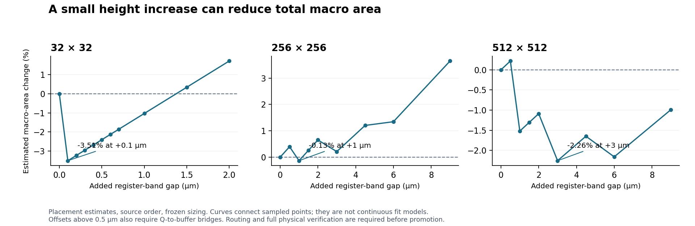

# Macro-area experiments — V2.2.8

The [larger-array follow-up](MACRO_AREA_LARGE_V2_2_8.md) adds register bridges
and subsequent physical checks. This document preserves the initial
exploration and its original validation limits.

This exploration compares further compaction against the
[periphery-height baseline](PERIPHERY_HEIGHT_V2_2_8.md). **The production
layout generator was unchanged in this initial exploration.** Candidates remain experimental: Calibre
could not acquire a DRC license in this session. Placement estimates and
limited geometry screens do not establish DRC/LVS, extraction, waveform
correctness or release qualification.

The [machine-readable record](../../data/MACRO_AREA_EXPLORATION_V2_2_8.json)
contains the trials, source identities, settings, generated-layout hashes,
checks and failed verification attempt. Historical evidence is unchanged.

## What the code makes expensive

`compact_core.py` fixes the cell at 1125 × 395 nm; `compact_array.py` adds
straps and the replica loads. `compact_slots.py` builds the write, sense and
precharge bands. `compact_bank.py` abuts compatible supply rails and places
two column halves around `compact_decoder.py`'s shared decoder.

`compact_center.py` places 7730 nm data-register slots below the write band,
aligns TIME_CONTROL with their bottom edge, and searches for enough central
width using `time_control.py`'s actual placement routine. It reserves five
100 nm routing tracks after the fit search and retains the 20.6 µm minimum
controller frame. Spare decoder lanes accept eligible overflow cells.

This makes total area discontinuous: a small height change can make an
additional controller row fit and remove several micrometres of width.
Optimizing peripheral height alone misses this effect. The prior reduction
already increased area at 32×32 and 512×512.

All experiments retain source topology, every MOS, total W/L, models, sizing
and timing tables, cell pitch and simulation RC profiles. A changed placement
can change finger partitions and wire parasitics.

## A. Trade a little height for less controller width

Increase `compact_center.REG_GAP` from its 300 nm default. This lowers both
data registers and the controller floor while keeping the write band and
array fixed. The existing register Q tracks overlap their write-buffer inputs
for the +0.1 and +0.5 µm native trials. The controller gains height and can
sometimes fit in a narrower frame. This intentionally increases overall height; the objective is total
macro area.

The screen runs the existing placement predicate and width search, keeping
all decoder conductor keepouts, spare-lane restrictions, frame floor and
escape allowance. The zero-change trials reproduce all five baseline frame
widths and areas. Estimates use baseline complete-macro bounds plus the
computed width change and added height. They assume routing does not require
additional overhang; only a completed GDS can establish actual bounds.

**Wiring limit:** `dense_slots.make_register_slot` extends Q only 370 nm
past the register frame, with a 70 nm end landing. The +0.5 µm trial retains
7.5 nm of overlap with the write-buffer M3 access. At +0.6 µm, those tracks
have a 92.5 nm gap. Larger offsets in this screen therefore require explicit
M3 Q-to-buffer bridges before native generation can pass its interface
connectivity audit. Such bridges are not implemented here. In particular,
the 256/512 height savings below are conditional placement estimates.

| Complete macro | Baseline area (µm²) | Best sampled extra gap (µm) | Frame width before → after (µm) | Estimated area (µm²) | Change |
| --- | ---: | ---: | --- | ---: | ---: |
| 32 × 32 | 2,310.4 | 0.1 | 23.1 → 20.6 | 2,229.3 | -3.51% |
| 64 × 64 | 5,242.5 | 0 | 25.6 → 25.6 | 5,242.5 | +0.00% |
| 128 × 128 | 14,175.4 | 0 | 37 → 37 | 14,175.4 | +0.00% |
| 256 × 256 | 45,187.6 | 1 | 63.8 → 60.5 | 45,127.4 | -0.13% |
| 512 × 512 | 158,231.2 | 3 | 113.8 → 89.2 | 154,661.3 | -2.26% |



This is a sampled search, not a proof of a global optimum. The production
width search is heuristic; its slicing and placement decisions can also
change at width thresholds. Each organization needs its own area comparison.

One complete 32×32 macro candidate finished native routing:

| Added gap | Actual GDS W × H (µm) | Actual area (µm²) | Change from current baseline |
| --- | --- | ---: | ---: |
| +0.5 µm | 63.5775 × 35.4650 | 2,254.8 | -2.41% |

The +0.1 µm candidate was stopped after a bounded 15-minute routing trial.
It did not produce a completed macro. Its estimated 3.51% saving remains
unconfirmed; no geometry, DRC or LVS pass is claimed for that attempt.

Completed candidates retain the source-device inventory and actual drawn gate area. Their
limited metal-spacing and opposite-well screens are recorded separately.
Calibre DRC/LVS remains unavailable; these are routed candidates, not qualified layouts.
No 256×256 or 512×512 height candidate was routed in this exploration.

## B. Reorder controller groups

Two isolated alternatives order controller subcircuits by descending or
ascending summed cell width. Each source subcircuit remains contiguous and
its internal gate order remains unchanged. DFF precedence, fixed-band
requirements, decoder-lane keepouts and antenna-tap policy still apply.

| Macro | Group order | Extra gap (µm) | Estimated area change |
| --- | --- | ---: | ---: |
| 32 × 32 | narrow first | 0 | 0.00% |
| 32 × 32 | wide first | 0 | 0.00% |
| 128 × 128 | narrow first | 0 | +0.00% |
| 128 × 128 | wide first | 0 | +0.00% |
| 256 × 256 | narrow first | 0 | -0.28% |
| 256 × 256 | wide first | 0 | -0.53% |
| 256 × 256 | wide first | 1 | -0.13% |
| 256 × 256 | wide first | 2 | +0.65% |
| 256 × 256 | wide first | 3 | +0.64% |
| 512 × 512 | wide first | 0 | +1.42% |
| 512 × 512 | wide first | 1 | -0.63% |
| 512 × 512 | wide first | 3 | -0.96% |

The mixed results reject one global replacement for source order. A future
planner could compare a small deterministic candidate set, but each selected
ordering still needs completed routing and physical checks. Combining width
ordering with extra height did not reliably improve on either separately.

## C. Tighten decoder trunk pitch

`compact_decoder.SLOT` reserves 300 nm per vertical trunk. Three alternatives
use 290, 285 and 280 nm. The trunks are 145 nm wide, while the official
FreePDK45 `Metal5.2` minimum space is 140 nm: 280 nm pitch leaves only
135 nm between parallel trunks. This is distinct from their via-cut width.

| External-control bank | Trunk pitch (nm) | Baseline W × H (µm) | Candidate W × H (µm) | Bank area change |
| --- | ---: | --- | --- | ---: |
| 32 × 32 | 290 | 63.0775 × 26.515 | 62.9275 × 26.515 | -0.238% |
| 32 × 32 | 285 | 63.0775 × 26.515 | 62.8525 × 26.515 | -0.357% |
| 128 × 128 | 290 | 187.4775 × 66.960 | 187.2075 × 66.960 | -0.144% |
| 128 × 128 | 285 | 187.4775 × 66.960 | 187.0725 × 66.960 | -0.216% |

A limited KLayout check of merged M1–M6 polygons finds zero minimum-space
markers for the original and 290 nm 32×32 banks. The 280 nm candidate has
seven M5 spacing markers and is rejected. Both 285 nm banks pass the
limited M1–M10 and opposite-well screens. The 285 nm pitch is exactly at
the simple M5 minimum; the 290 nm option retains 5 nm of extra spacing. These
checks cover only the listed minimum-space rules, not the full Calibre deck, antenna rules or LVS.

The 285/290 nm bank improvement is small and does not automatically translate
into a complete-macro improvement: a controller-limited macro can consume
the freed decoder width. Do not add this bank percentage to the controller
estimates.

## Validation and disposition

The study contains **63 placement trials** and eight native layout
attempts: two complete-macro attempts and six external-control banks (including the
128×128 control build and rejected 280 nm trial). Five targeted regression
tests pass with no skips. They cover source-device/model/W/L/node inventories,
terminal-key coverage, drawn gate count and area, actual GDS bounds, the
expected 280 nm spacing failure, and zero-offset baseline reproduction.
These metadata and geometry checks are not LVS. The timed-out routing attempt is explicitly excluded from generated-macro checks and recorded as an unsuccessful experiment.

Completed routed candidates pass the limited M1–M10 minimum-space and opposite-well
screens with zero markers, as do both 285 nm banks and the 290 nm 128×128 bank. The current
32×32 baseline passes the same screen. The 290 nm 32×32 bank passes the
M1–M6 minimum-space screen. Full Calibre verification attempts for the
290 nm 32×32 bank and the +0.5 µm 32×32 macro stopped at license checkout:
`Unable to acquire the first license` for `DRC (Flat)`. Neither produced a
DRC result; dependent LVS and extraction were not run. No additional Calibre
attempt was made for the other candidates after that repeated tool failure.

The next implementation to pursue is an area-aware controller-frame choice:
compare the current plan with modest register-band offsets at controller-row
thresholds, add checked Q-to-buffer bridges where existing tracks no longer
overlap, then route and verify the lowest-area feasible candidates. Keep
the current plan for decoder-limited sizes. The 285/290 nm decoder pitches are
separate, smaller candidates. The 280 nm pitch is geometrically rejected.

No new sizing, timing, RC, waveform, read/write margin, yield, IR-drop or
EM qualification is claimed. Restore Calibre license availability before
promoting any candidate; obtain extracted waveforms before making electrical
claims. No prior receipt applies to a changed geometry.

## Reproduction

Use the project's `openyield` Conda environment from the repository root and
the existing nominal, full mode-0 source decks with the frozen layout sizing
lookup. The [case manifest](../../../tests/spice/v228_macro_area_cases.json)
records the parameters and acceptance scope. All output directories must be
new. No simulator is required for these geometry experiments.

The completed height candidate can be reproduced without editing the production source:

```python
from pathlib import Path
from sram_compiler.layout.freepdk45 import compact_center

compact_center.REG_GAP = 800.0  # 300 nm baseline + 500 nm extra height
compact_center.generate(Path("path/to/deck.sp"),
                        Path("outputs/layout/compact/macro_area/new_macro32"))
```

For a decoder-only candidate, set `compact_decoder.SLOT = 285.0` or `290.0` before
calling `compact_bank.build(deck, output)`. These are process-local trial
settings, not supported CLI options. The local runners save the settings
alongside GDS and source hashes because the generator file hashes alone do
not encode these overrides. Run each trial in a fresh Python process.

The ignored `dev/macro_area/` scripts contain the placement sweeps, group
ordering, builds and limited spacing screen; ignored
`tests/test_macro_area_trials.py` contains the targeted regression checks.
They are not included in a fresh clone. Generated artifacts and logs remain
under `outputs/layout/compact/macro_area/`.
