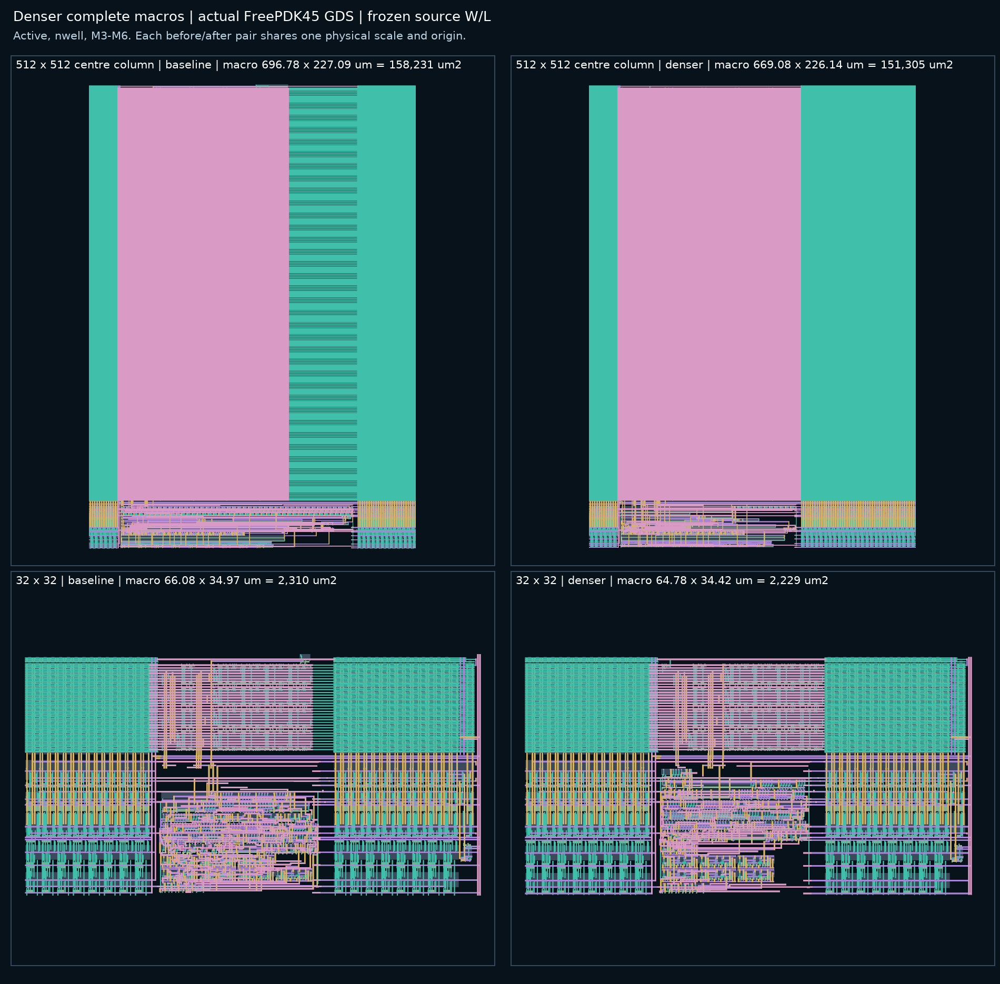

# Denser complete macros — V2.2.8

This revision reduces the complete compact macros below the
[periphery-height default](PERIPHERY_HEIGHT_V2_2_8.md) (commit `f302c76`).
Source topology, models, every transistor's total W/L, the bitcell pitch,
sizing/timing tables and simulation RC profiles stay frozen. The changes
are floorplan, placement and local routing only. Physical receipts do not
establish waveform correctness or release qualification.

| Complete macro | Baseline W × H (µm) | Denser W × H (µm) | Area (µm²) | Change | Floorplan | Calibre |
| --- | --- | --- | ---: | ---: | --- | --- |
| 32 × 32 | 66.08 × 34.965 | 64.78 × 34.417 | 2,229.5 | -3.50% | gap 402.5 nm, pad 1.7 µm; XRWL in decoder | 0 DRC / CORRECT LVS / R+C+CC |
| 64 × 64 | 104.58 × 50.130 | 104.58 × 49.180 | 5,143.1 | -1.90% | abutted, no pad; XRWL in decoder | 0 DRC / CORRECT LVS / R+C+CC |
| 128 × 128 | 187.98 × 75.410 | 187.98 × 74.460 | 13,996.8 | -1.26% | abutted, no pad; XRWL in decoder | 0 DRC / CORRECT LVS / R+C+CC |
| 256 × 256 | 358.72 × 125.970 | 351.12 × 125.020 | 43,896.7 | -2.86% | abutted, pad 4.6 µm; XRWL in decoder | 0 DRC / CORRECT LVS |
| 512 × 512 | 696.78 × 227.090 | 669.08 × 226.140 | 151,305.2 | -4.38% | abutted, pad 6.0 µm; XRWL in decoder | 0 DRC / CORRECT LVS |

All five complete macros pass Calibre DRC with zero results and strict LVS;
the 32/64/128 macros also have distributed R+C+CC extraction. Each keeps the
baseline's source deck and netlist hashes, MOS inventory, physical gate
count and drawn gate area. Nine targeted local tests pass without skips.
Bounds include every source instance, controller, register, replica, RWL
driver, latch, route and macro pin.

## Where the area went

The baseline macros left three kinds of unused area:

- **An empty strip beside the decoder.** At 256 and 512 rows TIME_CONTROL
  is wider than the decoder. The planner widened the gap between the
  decoder and the right array, so a 12.2 µm (256) or 33.7 µm (512) strip ran
  the full array height carrying only wordlines: about 2.8% and 4.3% of
  those macros.
- **Height outside the bank.** The replica wordline driver (XRWL) sat on top
  of the decoder, 417.5 nm above the bank. The per-column DIN accesses
  reached 370 nm below the register band, and 302.5 nm separated the
  register band from the write band.
- **Controller-row thresholds.** A small change in controller-band height can
  add a whole row of controller cells. The
  [initial exploration](MACRO_AREA_EXPLORATION_V2_2_8.md) estimated this
  effect but left the production choice unchanged.

The decoder itself is close to its gate area: two 1365 nm gate rows per
3160 nm band hold four wordline chains each. The 64×64 and 128×128 macros
remain decoder-limited, so they gain height only.

## Changes

### Decoder left pad instead of a gap beside the decoder

`compact_decoder.make_decoder(pad=...)` keeps the decoder's left M2 supply
spines, M1 rails and wells at its left edge and shifts every gate, trunk and
pin right by the pad. `compact_bank.build(decoder_pad=...)` records it as
`decoder_pad_nm`. The empty lower gate rows of the predecode region
(controller "lanes") widen by the same amount over the full array height,
while the block below the decoder widens as before. At 512 rows a
micrometre of pad adds about five times more usable controller area than a
micrometre of gap beside the decoder (block plus about 60 lanes versus the
block alone).

`compact_center` splits the lane scan into `_band_rows` (actual decoder
metal) and `_lanes(rows, pad)`. Lanes for any pad are the unpadded rows
shifted; with no pad they equal the previous scan, and a rebuilt padded bank
reproduces the shifted estimate. After choosing a pad, `generate()` rebuilds
the bank and confirms the fit on its actual metal.

Lane gates route into the decoder region, so lanes are only used when they
save at least `LANE_SAVING` = 1 µm over a lane-free pad. At 32 rows, 2.6 µm
lanes would have saved 0.2 µm; that trial exceeded 170 routing rip-ups
without converging and was stopped.

### Area-aware register gap

The register band's top VSS rail now abuts the write band's bottom VSS rail
(`REG_GAP` = 0). The register origin is exact rather than grid-snapped, which
would otherwise leave a 2.5 nm sliver between the rails. Generation fails if
the two rails are not one net. A Calibre probe of three register/write pairs
for both write-slot classes passed DRC with zero results.

`generate()` also considers taller controller bands: register gaps of 0 and
300–2300 nm in 100 nm steps (gaps of 140–280 nm would put the two VSS M4
bars at sub-rule spacing). For each gap it finds the smallest decoder pad
that fits, adds five 100 nm escape tracks and the 20.6 µm minimum frame,
estimates the macro bounds from the unpadded bank, and keeps the smallest
area. The register Q-to-write-buffer bridges from `f302c76` connect taller
gaps.

A frame at the 20.6 µm minimum width is routing-limited, so such a
candidate must also fit with `ROUTE_SLACK` = 400 nm less band height. At
32 rows the 400 nm gap is the first that holds the last controller row in
that frame; its native build passed 230 rip-ups without converging and was
stopped. The 800 nm gap routed with 16 rip-ups. The
[earlier exploration](MACRO_AREA_EXPLORATION_V2_2_8.md) saw the same split
between its +0.1 and +0.5 µm 32×32 trials.

Each gap also gets a second candidate when XRWL would not fit in the
decoder: the smallest pad (at least the escape tracks) that gives it room.
At 32 rows this 1.7 µm pad both lifts the frame above the minimum width and
removes XRWL's overhang. With the 400 nm gap it routed with 17 rip-ups and
is the chosen plan.

### Replica wordline driver inside the decoder

XRWL is built from the decoder's own compact gates and mirrored into the
upper gate row of the decoder's top band, at the lane origin of its empty
left region. Its rails land on the band's M1 rails and its wells merge with
the band's. `wl_en` comes from the decoder's top-edge M2 line, extended left
to the driver's B input with 35 nm via2 end enclosure. RWL rises on M3 and
drops onto the existing M6 replica wordline crossing. The driver is placed
before routing so the router sees its metal.

If that row is not empty — 32 rows without a pad, or 512 rows without one —
XRWL keeps its previous position above the decoder; the area estimate adds
its 417.5 nm overhang for such candidates and also evaluates the pad that
would give it room.

### Shorter DIN stubs and an inside RWL return

The data-register D tracks now end 70 nm below the band (landing at
−140 nm), 230 nm shorter. The DIN accesses still reach the macro's bottom
edge. With XRWL inside the decoder, the replica wordline return's 805 nm M9
landing became the top of the macro; its M7-to-M9 drop now starts low
enough for the landing to stay inside the bank outline.

### Same-net notches at bank conductors

The 256×256 candidate exposed a routing case: the controller's VSS route ran
on M6 one grid row above an off-grid register-rail VSS stub that it is
allowed to join, leaving a 55 nm same-net gap that the planner's spacing
check rejected. `time_control._bridge_owned` now fills such gaps between a
net's routes and the M4–M6 bank conductors it owns, and fails if the fill
would come within spacing of foreign metal. A rebuild of the failing case
with only this fill added passed the planner check and Calibre DRC.

## Electrical scope

The pad lengthens each left-half wordline's M6 crossing and the decoder
trunks by the pad width (6.0 µm at 512 rows). XRWL now drives the replica
wordline from the left side of the decoder, so the replica path's far end
(the right array's far edge) gains about one decoder width of M6 in series.
Controller lanes reach further into the decoder at 256/512 rows. No
waveform, extracted timing, read/write margin, yield, IR-drop or
electromigration analysis ran for these changes; the compiler's scoped
simulation RC profiles still do not describe this geometry.

## Not pursued here

- The 1 µm precharge-to-array gap holds the decoder supply feeds (two M4
  bars, M5/M3 left feeds, M6 trunk landings) and the decoder riser jogs.
  About 0.25 µm could be recovered with coordinated moves.
- Controller lanes use only the lower gate row of each decoder band. Mirrored
  upper-row lanes could shrink the 256/512 pads further.

## Reproduction

Use the `openyield` Conda environment and the nominal mode-0 source decks
listed in the [case manifest](../../../tests/spice/v228_macro_density_cases.json).
The normal `layout bank --with-controller` command applies the new floorplan
choice; generate into fresh directories and verify with
`layout verify-full`.

Local `dev/macro_density/` holds the pad estimator, builds, Calibre runners,
abutment probe and evidence assembler; `tests/test_macro_density.py` holds
the targeted regression checks. Both are ignored by project policy and are
not part of a fresh clone. Raw outputs are under
`outputs/layout/compact/macro_density/`; the
[evidence JSON](../../data/MACRO_DENSITY_V2_2_8.json) binds each macro to its
source deck, generator, GDS and Calibre receipts.
