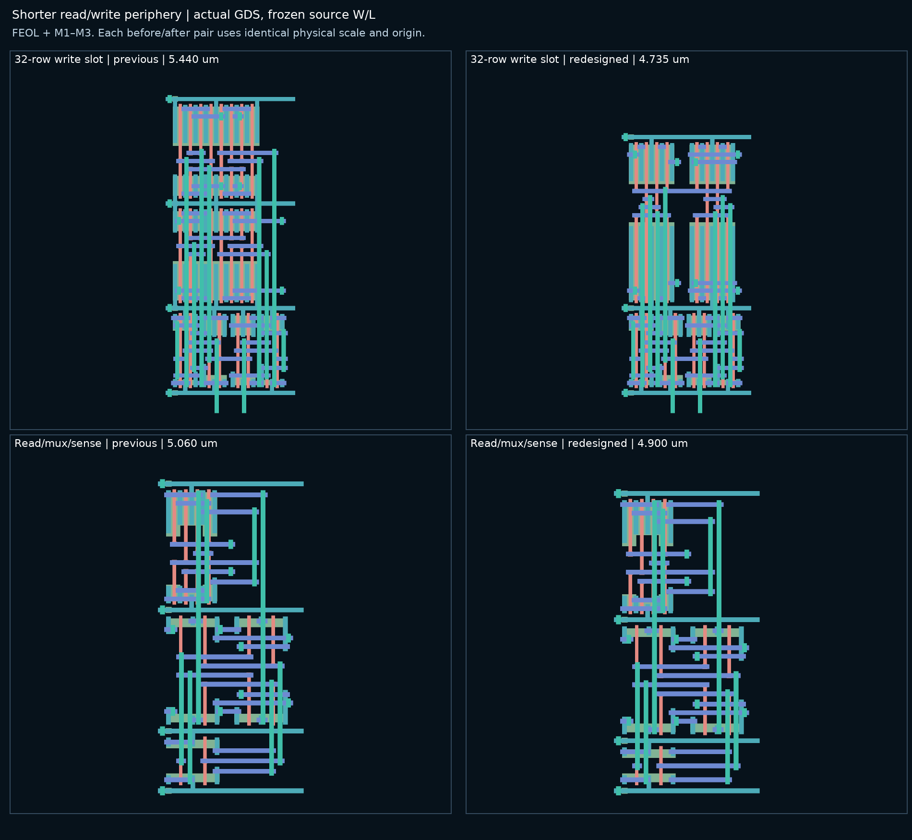

# Shorter read/write periphery — V2.2.8

This revision updates the read/write placement described in
[the compact-cell strategy](COMPACT_CELL_V2_2_8.md). The column-pair pitch
remains 2250 nm. Source topology, models, total transistor W/L, sizing and
timing tables, bitcells, precharge cells, and simulation RC profiles stay
frozen.

## Placement

The write slot now has two rows. Its buffer/input-inverter row is unchanged.
The second row contains two isolated diffusion islands, one per column.
Within each island, BL and BLB tristates share their central supply contact:

- PMOS diffusion: BL — int1 — VDD — int3 — BLB.
- NMOS diffusion: BL — int2 — VSS — int4 — BLB.

Each tristate MOS uses one full-width finger instead of two half-width
fingers. This removes one pair of supply rails and one gate-contact region.
Four gate levels keep EN, DINB, DIN and ENB separate. BL and BLB use different
strip-bar levels to clear the bitline and supply access stacks. The replica
retains only the U driver, at the same coordinates and row heights, with DIN
tied to VSS as in the source.

The write slot now ends at VSS, allowing direct abutment to the read slot's
lower VSS rail. The existing supply-aware bank placer consequently removes
the former 425 nm opposite-well gap. No bank-routing constants were changed.

In the read slot, the two select-inverter output buses have disjoint
horizontal extents. They now share one strip-bar level, reducing that row
from 985 to 825 nm. The mux and amplifier rows retain their geometry.

The shorter controller band exposed a decoder antenna-tap clearance issue
at 128×128: eight tap pwells sat only 70 nm from the last logic row's nwell.
The controller now checks the tap's 130 nm well half-width plus the required
225 nm spacing against its placed nwells. A crowded tap moves to the other
side of the same pin, retaining the 350 nm pin-to-tap offset. If neither
position is legal, generation fails before routing. Uncrowded taps keep
their original position. This changes no source transistor or sizing policy.

| Tiling dimension | Before | After | Reduction |
| --- | ---: | ---: | ---: |
| Write, 32-row source class | 5.440 µm | 4.735 µm | 0.705 µm |
| Write, 64–512-row source class | 7.965 µm | 7.260 µm | 0.705 µm |
| Read/mux/sense | 5.060 µm | 4.900 µm | 0.160 µm |
| Write-to-read gap | 0.425 µm | 0 | 0.425 µm |
| Total periphery stack | — | — | **1.290 µm** |

Figure labels give tiling heights; supply-rail and pin overhangs are shown.

## Physical evidence

Final macro bounds and verification receipts are recorded in
[the evidence JSON](../../data/PERIPHERY_HEIGHT_V2_2_8.json).

| Complete macro | Before W × H (µm) | After W × H (µm) | Area change | Calibre |
| --- | --- | --- | ---: | --- |
| 32 × 32 | 63.5775 × 36.255 | 66.0775 × 34.965 | +0.23% | 0 DRC / CORRECT LVS |
| 64 × 64 | 104.5775 × 51.420 | 104.5775 × 50.130 | -2.51% | 0 DRC / CORRECT LVS |
| 128 × 128 | 187.9775 × 76.700 | 187.9775 × 75.410 | -1.68% | 0 DRC / CORRECT LVS |
| 256 × 256 | 355.4175 × 127.260 | 358.7175 × 125.970 | -0.09% | 0 DRC / CORRECT LVS |
| 512 × 512 | 683.1775 × 228.380 | 696.7775 × 227.090 | +1.41% | 0 DRC / CORRECT LVS |

All five macros are **1.290 µm shorter**. The 32/64/128 macros also have
completed distributed R+C+CC extraction. The 256/512 checks stop after
DRC/LVS. External-control banks at 8×128, 16×4, 32×32 and 64×64 also
pass DRC/LVS; an integrated 16×4 controller was not run.

Eight targeted regression tests pass, with no skips. The separate legacy
precharge test import failure is documented below.

The preceding controller-compaction revision is the comparison baseline;
its exact layout/source/generator identities are retained in the evidence.
Controller sizing and cell placement policy remain unchanged.
Shorter periphery leaves less space for the controller below the decoder,
so the existing planner may widen its frame. Height savings therefore do
not necessarily imply area savings for every organization.

The local component suite compares 28 before/after slots across seven source
decks (8, 16, 32, 64, 128, 256 and 512 rows), including normal and replica
write/read cells. It checks source-device inventories, summed W, L, models,
connectivity, terminal coverage, and actual active/poly gate counts and area.
A separate check compares precharge polygons layer by layer against the
saved baseline. The complete-macro suite checks source ownership, column and
register placement, actual GDS bounds, and exact physical receipt hashes.
Fixed controller geometry is also checked for opposite-well overlap and
225 nm separation at all five macro sizes before routing. The failed first
128×128 receipt remains recorded alongside the corrected geometry.

The older local `tests/test_compact_precharge.py` could not load because it
imports the retired `dense_slots.make_precharge_slot`. Its failed import is
preserved in the evidence; no checks from that module are claimed as passed.
The direct precharge polygon comparison and bank/macro Calibre checks cover
the unchanged precharge geometry and its abutment in this revision.

Refingering changes diffusion/contact geometry and local parasitics; BL/BLB
routing is not a capacitance-matching proof. No waveform, extracted timing,
read/write margin, yield, IR-drop or electromigration checks ran. The smaller
geometry does not qualify sizing tables or simulation RC profiles.

## Reproduction

Use the `openyield` Conda environment, the frozen layout sizing lookup and
nominal mode-0 source decks as described in the
[compact strategy](COMPACT_CELL_V2_2_8.md#reproduction-and-implementation).
The normal `layout bank` and `layout bank --with-controller` commands select
these slots automatically. Generate into fresh output directories; the
[case manifest](../../../tests/spice/v228_periphery_height_cases.json) lists
the source parameters, matrix and physical acceptance checks.

The local scripts under `dev/periphery_height/` and regression runners under
`tests/` are ignored, following repository policy. They are not part of a
fresh clone. GDS, source decks and raw verification results are retained
under `outputs/layout/compact/periphery_height/`; the committed JSON records
hashes and scope rather than embedding those generated files.
