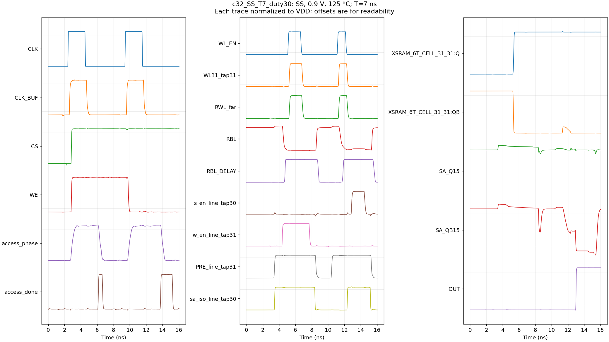

# V2.2.9: self-timed 6T access and recovery

**Historical initial V2.2.9 implementation.** The [area-constrained revision](ACCESS_SPEEDUP_AREA_V2_2_9.md) supersedes its compact default sizing, clocks and area. Measurements below retain their original source and scope.

The extracted 32×32 clock changes from **9.50 ns to 7.40 ns**, a **22.1%**
reduction. Its absolute read deadline is **4.20 ns** after external CLK50.
The [controller evidence](../../data/ACCESS_SPEEDUP_V2_2_9.json) records the
finite screen; larger-class clocks are explicitly estimated.

V2.2.9 uses the standard 2:1 column mux. The new controller runs decoder
setup and write isolation alongside PRE release, senses after far isolation
settles, and ends its access from physical completion rather than clock fall.
Existing peripheral and buffer W/L classes remain frozen. The V2.2.8
controller remains available for 10T and explicit legacy diagnostics.

## Circuit and timing contract

An added phase register captures selection on rising `clk_buf`. Asynchronous
clear resets both its master and slave, allowing completion while the clock
stays high. PRE then waits for physical WL release and both enables off.
Write drivers cover the WL tail; read isolation stays asserted through that
tail. Far sense enable starts the read-resolution allowance, and far replica
WL starts the write allowance. Row/column completion references take their
larger count, with the measured 32×32 circuit retaining eight stages.

The original threshold-detector replacement did not qualify: 29 nominal
candidates and 1,800 mismatch samples did not establish the required trip
bounds. Existing settling guards remain. The sense-enable fallback uses far
`iso_ready`; it permits a read WL tail to overlap regeneration without
reconnecting the inputs prematurely.

Decoder allowance covers **every** output, including unselected rows. The
original two-stage assumption produced a 512-row first-read pulse on
unselected WLs. The schematic profile also needed longer references with
local RC: a 32-row FF-cold/SF-cold first read otherwise pulsed WL7. Corrected
references are checked with complete decoders, actual frozen driver input
loads and the retained local RC; their estimated WL capacitance is recorded
separately from physical extraction.

The recovered state includes WL, write/sense enables, ISO and replica delay
low; every bitline at 98%; PRE on; and all completion timers and settling
guards reset. Checking only one bitline at 90% misses latent state. Recovery
is due before the next capture. The legacy early recovery reserve is removed
from the new controller because the clock policy already supplies its margin.
Single-operation traces include the final recovery before another capture.

## Sense margin

[Extracted-slot characterization](../../data/ACCESS_SPEEDUP_SENSE_OFFSET.json)
contains 1,000 independent per-device samples at each of six PVT points,
10 bisections per offset, and dual-rail/latch resolution measurements. The
slot retains full R+C+CC; the output latch in that isolated study is
schematic. The bar is `max(abs(mu) + 6*sigma + Vsys, 0.10*VDD)`: nominal
macros need 1.5 times it, mismatch samples need the bar, and each column
must reach it with the expected bit polarity before isolation.

The isolated study's 30 mV system term is provisional. Macro rail compression
and full-versus-quiet bitline-coupling sensitivity set the system-margin
record. Quiet-coupling runs retain equal shunt load and are sensitivities.
They do not replace the coupled qualification network. The completed
[macro measurement](../../data/ACCESS_SPEEDUP_SYSTEM_MARGIN.json) gives
48.707 mV maximum rail compression and 7.012 mV maximum coupling sensitivity.
Their sum sets **Vsys = 55.719 mV** for the final waveform checks. The offset
record keeps its original provisional field; the final scorer reads this
separate measured system term.

SA internal rails are checked at completion and while the footer remains
active. They may precharge before the external deadline. The output latch
and stored data retain their expected value through that deadline and until
the next capture.

## Measured anchor and clock policy

The corrected 32×32 macro passes DRC 0, LVS CORRECT and distributed R+C+CC
extraction. All 9,900 source MOS remain; the extracted supply mesh is fed at
every macro supply pin, and kit contact/via resistances remain unchanged.
Series reduction is 20 ohms, shorts below 1 ohm and grounded coupling below
10 aF, matching the scoped baseline method.

The SS 0.9 V 125 °C four-access characterization at 12 ns gives 3.730 ns
capture-to-data and 6.452 ns capture-to-full-recovery. A 5% per-device
post-layout mismatch spot (seed 20261105) passes at 3.783 / 6.505 ns. These
are measured completion times. Ten nominal four-access seq/mixed cases cover
SS, FS-hot, FF-hot, SF-cold and FF-cold; the same-size compact schematic
matrix adds three independent 5% per-device seeds per corner. The measured
post-layout SS spot raises the transferred SS mismatch factor when necessary.
The resulting worst budgets are **3,784 ps access / 6,693 ps cycle**, before
the single clock margin. All final checks use the measured offset/noise bar
and correct stored-bit polarity.

The extracted macro also passes SS/FF-cold 30/70% duty, read/write completion
with CLK held high, first-read/mux-toggle and deselected-input-toggle cases.
SS at 7 ns/30% duty and FF-cold at 7 ns/70% duty pass below the published
period. A 6 ns SS negative control fails guard/ISO/RBL recovery before the
next capture; it is an expected failure. The extra diagnostic first-read
trace originally requested a 6 ns deadline extending past a selector change.
Its final observer-only score applies the stricter published 4.20 ns deadline
to the unchanged electrical trace. Original results and metadata remain.

New timing tables hold joint row/column budgets and separate absolute read
deadlines after capture. Each budget gets one 10% margin and rounds upward
to 50 ps. Explicit joint classes avoid counting the same controller path in
both dimension excesses. Larger-class estimates retain their model
uncertainty and evidence status; they do not establish post-layout
qualification of those macros. Changes to sizing, timing references,
periphery, model contents or physical RC cannot silently reuse a published
baseline.

| Geometry | Previous compact period (ns) | V2.2.9 period (ns) | Read deadline (ns) | New evidence |
|---|---:|---:|---:|---|
| 32×32 | 9.50 | 7.40 | 4.20 | Extracted anchor plus sampled mismatch |
| 64×64 | 12.00 | 10.70 | 5.85 | Extrapolated |
| 128×128 | 21.25 | 15.80 | 9.00 | Extrapolated |
| 256×256 | 27.75 | 27.10 | 14.65 | Extrapolated |
| 512×256 | 36.00 | 30.10 | 19.20 | Extrapolated |
| 32×256 | 14.00 | 26.20 | 12.10 | Extrapolated |
| 128×256 | 23.25 | 26.40 | 13.15 | Extrapolated |

The previous wide-array settings were not waveform-qualified. Complete
recovery and explicit uncertainty make some new wide classes slower; this
release does not claim a speedup for every shape. The
[compact estimates](../../data/ACCESS_SPEEDUP_ESTIMATES.json) retain the
historical physical scaling factors, actual frozen loads, decoder coupons,
separate read/write event paths and conditional completion bounds. They do
not transfer the small array's K=2 replica gain to larger K=1 classes.

The normal driver profile selects **5.65 ns / 3.50 ns** for the 32-class
period/deadline. It uses a schematic reference: 40 eight-row cases cover the
five corners, local RC off/on and three mismatch seeds, with 32×32 SS
RC-off/on anchors and dedicated first reads. Its conservative 10% mismatch
floor is separate from the one 10% clock margin. The
[schematic estimates](../../data/ACCESS_SPEEDUP_SCHEMATIC_ESTIMATES.json)
record larger per-path control-bar references, reset costs and conditional
data/completion bounds. Clock latency reserve does not prove the correctness
of a settling interlock. Both profiles preserve their measured small-class
circuits when extending large-class references.

All 20 final-period confirmations at 5.65 ns / 3.50 ns pass: ten nominal
8×8 corner/RC cases, two SS mismatch samples, four SS single read/write
cases, two full 32×32 SS cases and two 32×32 FF/SF first reads with local RC.
Both production runtime gates check each single operation's final capture
and recovery against actual Xyce measures. The automatic-default decks are
electrically identical to these simulated decks. In the normal 512×256 class,
estimated handoff and timer-reset costs increase the period from the previous
36.00 ns design setting to 36.55 ns.

Final recovery has separate control-state and bitline checks. `VRECOVERY_ERROR`
samples the complete boundary state at the recovery endpoint, including the
last access in a cropped trace; `VRESTORE_ERROR` retains its 2% bitline check.
The independent waveform checker also requires completion timers and guards
to reset there. Fault-injected timer/guard tails are rejected. Xyce remeasurement
of unchanged saved transients confirms all 20 native cases, the extracted
7 ns positive case and the expected 6 ns failure. Legacy delay diagnostics
whose targets fall outside cropped traces retain their original failed
measures; full-waveform completion times determine these clock budgets.

The first write and read show access continuing after CLK falls, write drive
covering the physical WL tail, sense regeneration while ISO is asserted and
the output latch retaining its result after the sense footer turns off.

The added completion logic and routing increase the 32×32 footprint from
2,229.480 to 2,480.774 square micrometres, **11.27%**, with source MOS count
9,556 to 9,900. Existing driver classes are unchanged.

## Large-array post-layout follow-up (November 2026)

The published area-revision clocks for 128×128, 256×256 and 512×256 were
checked after release on extracted macros from the production generator.
Each macro passes DRC 0, LVS CORRECT and R+C+CC extraction. The 32×32
reduction policy is reused: 20 Ω series merge, 1 Ω shorts, 10 aF grounded
coupling, and every supply pin fed. Each case runs four accesses with nominal
devices from the schematic DC operating point. Simulation uses PrimeSim HSPICE
V-2023.12-SP1 (`-hpp -mt 8`, `runlvl=5`). On all 22 V2.2.9 32×32 post-layout
decks, HSPICE matched Xyce: identical verdicts and check counts, phase
margins within 10 ps, restore within 33 ps, sense margin within 1.4 mV. The
V2.2.9 scorer is unchanged. All three classes were extrapolated before this
check; it does not change any published clock.

| Geometry | Clock / read deadline (ns) | Cases | Result | Tightest recorded margin |
|---|---|---|---|---|
| 128×128 | 15.85 / 9.35 | 12: SS, FS-hot, FF-hot, SF-cold, FF-cold × seq/mixed; FF/SF-cold first read | **12/12 pass** (19,951–21,312 checks) | read completion 157 ps (FF −40 °C seq); sense 0.815 V |
| 256×256 | 27.00 / 14.80 | SS 0.9 V 125 °C seq (28 h) | **pass** (39,663 checks) | read completion 583 ps; sense 0.771 V |
| 512×256 (shipped macro) | 30.10 / 19.20 | SS 0.9 V 125 °C seq (41 h) | **fail**: 3,852 of 45,807 checks | cell high node 0.78–0.79 V |
| 512×256 (M8 VDD strap) | 35.50 / 19.20 | SS 0.9 V 125 °C seq (FineSim, 3.5 h) | **pass** (45,807 checks) | restore 6,405 ps before capture; sense 0.712 V; read output 3,107 ps |
| 512×256 (M8 VDD strap) | **35.95 / 17.75** (table) | SS 0.9 V 125 °C seq (FineSim, 4.6 h) | **pass** (45,807 checks) | restore 6,853 ps before capture; read output 1,654 ps; cycle 32,669 ps, access 16,095 ps |
| 512×512 (M8 VDD strap) | 40.00 / 22.00 (diagnostic) | SS 0.9 V 125 °C seq (FineSim, 9.3 h) | **fail**: controller not recovered at the next capture | guard-dominated write cycle, recovery ≈ 50.5 ns |
| 512×512 (M8 VDD strap) | 62.75 / 32.05 (ladder, outside the envelope) | SS 0.9 V 125 °C seq (FineSim, 10.2 h) | **pass** (79,087 checks) | restore 12,730 ps before capture; read output 7,721 ps; sense 0.761 V; cycle 59,038 ps, access 24,328 ps |

At 128×128 SS (15.85 ns clock), the measured capture-to-data time is 6.60 ns
and capture-to-full-recovery is 11.02 ns. The last bitline restores 5.4 ns
before the next capture. That idle tail motivates
[overlapped recovery](OVERLAPPED_RECOVERY_V2_2_9.md).

The 128×128 first reads initially failed the whole-window decoder reserve
(1.5 × setup): −685 ps at FF −40 °C and −813 ps at SF −40 °C. The slowest
"settle" was the selected row's own `DEC_WL`. Its WL driver pulls that drain
to about 80% VDD after `WL_EN`. This is the intended access, not a decoder
race. The reserve now measures the decoder settle before `WL_EN`, giving
+107 ps and +139 ps. After `WL_EN`, selected `DEC_WL` stays ≥ 0.72 V and
unselected rows ≤ 51 mV. Both measures are kept in the case records. At
32×32 the two formulas agree.

**512×256 failure analysis.** The extracted 512×256 macro fails at SS
0.9 V 125 °C with two symptoms. Both causes were read from the failed trace
(column extracts of the 3.2 GB waveform table).

* *Cell supply droop* is the strap-row VDD rail. Each half-array's bitcell
  VDD is a 65 nm M1 rail along the bottom and top well-strap rows, joined to
  the half's M4 trunk at the trunk end only; the columns' VDD M2 lines hang
  between those two rails. The whole half-array's static current flows along
  the two rails, so the droop grows with the row count while the rail
  resistance does not (128×128 10 mV, 256×256 63 mV, 512×256 110 mV). The
  stored-high level falls smoothly from the trunk end to the far end of each
  half, 0.879 → 0.789 V on the left and 0.897 → 0.825 V on the right, and is
  identical on rows 0, 128, 256, 384, 510 and 511. The grid had also skipped
  62 of 64 left-core VDD trunk joins. Fix: `power_grid.array_vdd_straps`
  adds, over each half's bottom strap row, a 500 nm M8 VDD strap merged into
  the half's vertical M8 strap, with M2–M8 stacks onto the column VDD lines
  every fourth column (pads from M4 up sit 20 nm towards the column centre,
  clear of the bitline-drop via4). The top strap row offers no stack site
  (M3 row-edge rail, right-half M7 top pin) and keeps its trunk link; the
  remaining series path is a column's two M2 lines, below 1 mV. At 32×32 the
  strap adds eight stacks at unchanged area.
* *Incomplete bitline restore* is not a drop: near-end, far-end and
  periphery-tap bitline levels agree within 3 mV in every column, and the PRE
  line stays below 8 mV. It is the restore time constant. After PRE turns on,
  the bitline deficit decays with τ = 1.8–2.0 ns (512-row bitline, precharge
  at its 256-column cap), so 0.98 VDD is reached 6.4–7.3 ns after PRE-on in
  all four cycles, 29.5–32.2 ns after capture (write cycles worst). The
  extrapolated 30.10 ns clock leaves 4.8–5.4 ns after PRE-on; 256×256 has
  8.1 ns at 27.00 ns. The clock rule (capture through complete recovery, one
  10 % margin) gives 35.4 ns.
* The −2,520 ps write-completion margin is an artifact of the droop: the
  written cells flip within 0.5 ns of WL-on, but their high node (0.81 V)
  never enters the scorer's 0.1 VDD retention band.

Status: the macro rebuilt with the M8 VDD strap (area unchanged, 64
stacks, DRC 0, LVS CORRECT, extracted) **passes** the SS 0.9 V 125 °C
sequence at **35.50 ns / 19.20 ns**: 45,807 checks, no failure. The
stored-high nodes now sit at 0.894–0.899 V in every probed column (0.789 V
before at column 0), every far bitline is at 0.890–0.893 V at each capture,
the write-completion margin is +4,983 ps and supply compression 51 mV. The
measured capture-to-full-recovery is 32,670 ps and capture-to-output
16,093 ps, so the clock rule gives **35.95 ns** with a **17.75 ns** read
deadline. The confirmation run at those values also passes (45,807 checks;
cycle 32,669 ps, access 16,095 ps), and the 512×256 joint class in
`layout_timing_lookup.json` now carries those measured budgets with
status `postlayout`, replacing the extrapolated 27,330 / 17,419 ps
(30.10 / 19.20 ns). That run
and later large-array runs use FineSim V-2023.12-SP1 in `spicexd` mode on
the unchanged translated deck (8 threads, 20 ps maximum step), which on the
32×32 and 128×128 SS cases reproduces every HSPICE verdict and check count
with timing margins within 10 ps and sense margins within 0.2 mV at four
times the speed; FineSim's Pro (FastSPICE) mode is not used for evidence
(100 ps, 20 mV at 128×128). The comparison is recorded in
[FINESIM_VALIDATION_V2_2_9.json](../../data/FINESIM_VALIDATION_V2_2_9.json). Until it
is the evidence for the table entry; the earlier 30.10 ns clock was too
short for the restore. The 512×32/64/128 joint classes are now measured as
well, on macros with the `read_held` latch, the strap and the 512-row band
placement. SS sequences at a relaxed 35.95 ns gave capture-to-full-recovery /
capture-to-data of 14,764 / 10,017, 15,679 / 10,490 and 22,054 / 13,695 ps. The
table clocks 16.65 / 17.25 / 24.30 ns (512×32 raised to the 256×32 cycle) pass
SS, SF −40 °C, FS / FF 125 °C and FF −40 °C sequences (5/5 each).
The earlier extrapolations (25.25 / 25.55 / 26.45 ns) were conservative, not
short. 512×512 has no automatic clock; its
strap macro is built and verified (area unchanged, 128 stacks). Its SS
diagnostic at 40.0 / 22.0 ns fails for a different reason: the 512-column
class is guard-dominated. W_EN turns on 12.0 ns after capture, the WL at
19.1 ns, the write completes at 23.2 ns, but the write-drive guard holds
W_EN until 37.3 ns and PRE turns on at 43.4 ns, so recovery (about
50.5 ns) overruns the period and the next read captures an unreset
controller. Cells and bitlines are healthy (sense 0.687 V, restore 17 ns
before capture). At the ladder's 62.75 / 32.05 ns the same macro
**passes** (79,087 checks; restore 12.7 ns before capture, read output
7.7 ns, sense 0.761 V). The measured capture-to-full-recovery is
59,038 ps and capture-to-data 24,328 ps, so the clock rule would give
64.95 / 26.80 ns; the run at 62.75 ns passes because the last recovery
event (a latent timer reset) still precedes the next capture by 3.7 ns.
512×512 stays outside the supported 512×256 envelope and gets no table
entry; the strap macro is the reference for that class.

A further 256-row finding from the overlapped-recovery matrices applies to
V2.2.9 as well: at 125 °C (FF 1.1 V and FS 0.9 V) the precharged
far-bitline plateau of a 256-row array is leakage-limited to 0.980–0.985
VDD, at the 0.98 VDD restore criterion (SS: 0.990–0.992; 128 rows at FF
125 °C: 0.993–0.996). The shipped 256×256 macro was simulated only at SS;
its hot-corner restore checks would fail by 1–3 mV for the same DC reason.
Decision: the precharge is kept and the scorer's far-bitline restore and
replica-reset levels are 0.97 VDD (differential sensing tolerates it). At 512
rows the plateau is 0.964–0.970 VDD (FF 1.1 V 125 °C), so the level is now
0.95 VDD (overlap 512×256 also shows a 4 mV coupling dip at admission); the
V2.2.9 512×256 FF/FS 125 °C sequences pass at it (sense margin 0.784 /
0.672 V).

**Read-completion latch.** `read_complete` was AND(`read_resolved` pulse,
WL-off guard, `we_bar`). On 256-column arrays at FF −40 °C the far `s_en` pulse
ends before the 44-stage WL-off guard releases, and the read never completes.
The controller now latches the resolved state (`read_held`). With it, V2.2.9
passes at its table clocks: 32×32 12/12 and 64×64 / 128×128 12/12 each
(5 corners × seq/mixed plus FF/SF −40 °C first reads),
and 256×256 8/8 at 27.00 / 14.80 ns (SS seq/mixed, the other four corners
seq, FF/SF −40 °C first reads).

**Waveform contract and wide arrays.** The scorer now judges control-signal
ordering at the 0.2 VDD device-off level (see the
[overlapped-recovery record](OVERLAPPED_RECOVERY_V2_2_9.md)). Short wide
classes (32×256, 64×256), never simulated before, failed strict FF −40 °C
enable-ordering checks with the row-class sizing; at the device-off level the
V2.2.9 controller passes them. 64×256 and 128×256 now use the 256×256
peripheral sizing. Every non-square class passes SS and FF −40 °C / 125 °C
sequences at its table clock (3/3 for each of the 12 classes).
See [OVERLAPPED_RECOVERY_V2_2_9.md](OVERLAPPED_RECOVERY_V2_2_9.md). The case records, provenance and final-sample levels are in
[ACCESS_SPEEDUP_LARGE_POSTLAYOUT_V2_2_9.json](../../data/ACCESS_SPEEDUP_LARGE_POSTLAYOUT_V2_2_9.json).

## Evidence and limits

- [Protocol](../../../tests/spice/v229_access_speedup_cases.json).
- [Baseline segments](../../data/ACCESS_SPEEDUP_BASELINE.json) and
  [detector feasibility](../../data/ACCESS_SPEEDUP_DETECTORS.json).
- [Extracted asynchronous-clear register](../../data/ACCESS_SPEEDUP_PHASE_REGISTER.json).
- [Offset characterization](../../data/ACCESS_SPEEDUP_SENSE_OFFSET.json).
- [Measured macro system margin](../../data/ACCESS_SPEEDUP_SYSTEM_MARGIN.json).
- [Controller, mismatch and clock evidence](../../data/ACCESS_SPEEDUP_V2_2_9.json).
- [Compact estimates](../../data/ACCESS_SPEEDUP_ESTIMATES.json) and
  [schematic estimates](../../data/ACCESS_SPEEDUP_SCHEMATIC_ESTIMATES.json).
- [Large-array post-layout follow-up](../../data/ACCESS_SPEEDUP_LARGE_POSTLAYOUT_V2_2_9.json).

Earlier prototypes with an
incorrect shared clock-gate definition, and duty cases whose source ignored
the requested duty, are excluded from frozen-circuit qualification. Failed
attempts and their original provenance remain in local outputs.

This is a finite functional/timing screen of the stated model, PVT and
variation scope. It does not establish foundry signoff or array yield.
