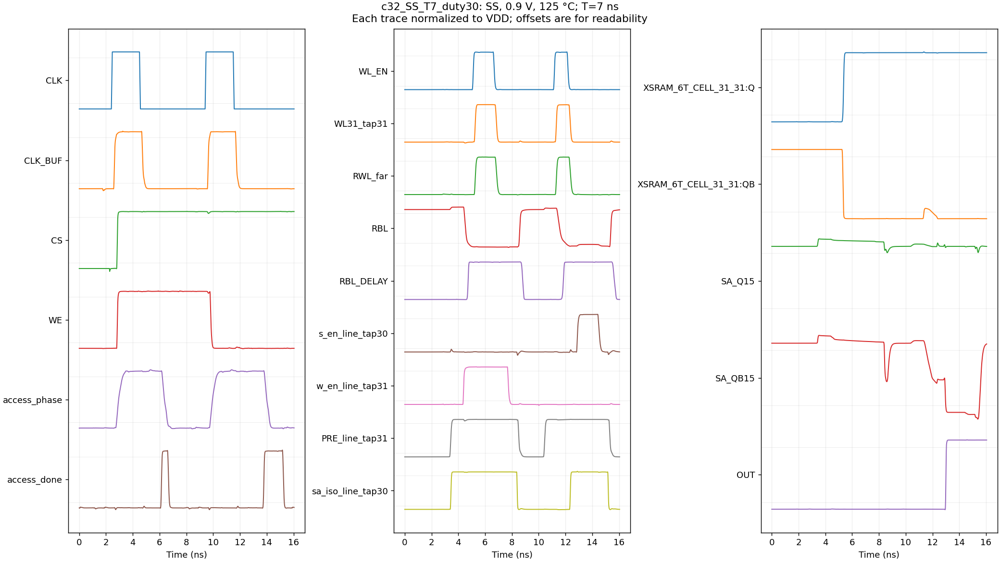

# V2.2.9: self-timed 6T access and recovery

The extracted 32×32 clock changes from **9.50 ns to 7.40 ns**, a **22.1%**
reduction. Its absolute read deadline is **4.20 ns** after external CLK50.
The [controller evidence](../../data/ACCESS_SPEEDUP_V2_2_9.json) records the
finite screen; larger-class clocks are explicitly estimated.

V2.2.9 uses the standard 2:1 column mux. The new controller runs decoder
setup and write isolation alongside PRE release, senses after far isolation
settles, and ends its access from physical completion rather than clock fall.
Existing peripheral and buffer W/L classes remain frozen. The V2.2.8
controller remains available for 10T and explicit legacy diagnostics.

## Circuit and timing contract

An added phase register captures selection on rising `clk_buf`. Asynchronous
clear resets both its master and slave, allowing completion while the clock
stays high. PRE then waits for physical WL release and both enables off.
Write drivers cover the WL tail; read isolation stays asserted through that
tail. Far sense enable starts the read-resolution allowance, and far replica
WL starts the write allowance. Row/column completion references take their
larger count, with the measured 32×32 circuit retaining eight stages.

The original threshold-detector replacement did not qualify: 29 nominal
candidates and 1,800 mismatch samples did not establish the required trip
bounds. Existing settling guards remain. The sense-enable fallback uses far
`iso_ready`; it permits a read WL tail to overlap regeneration without
reconnecting the inputs prematurely.

Decoder allowance covers **every** output, including unselected rows. The
original two-stage assumption produced a 512-row first-read pulse on
unselected WLs. The schematic profile also needed longer references with
local RC: a 32-row FF-cold/SF-cold first read otherwise pulsed WL7. Corrected
references are checked with complete decoders, actual frozen driver input
loads and the retained local RC; their estimated WL capacitance is recorded
separately from physical extraction.

The recovered state includes WL, write/sense enables, ISO and replica delay
low; every bitline at 98%; PRE on; and all completion timers and settling
guards reset. Checking only one bitline at 90% misses latent state. Recovery
is due before the next capture. The legacy early recovery reserve is removed
from the new controller because the clock policy already supplies its margin.
Single-operation traces include the final recovery before another capture.

## Sense margin

[Extracted-slot characterization](../../data/ACCESS_SPEEDUP_SENSE_OFFSET.json)
contains 1,000 independent per-device samples at each of six PVT points,
10 bisections per offset, and dual-rail/latch resolution measurements. The
slot retains full R+C+CC; the output latch in that isolated study is
schematic. The bar is `max(abs(mu) + 6*sigma + Vsys, 0.10*VDD)`: nominal
macros need 1.5 times it, mismatch samples need the bar, and each column
must reach it with the expected bit polarity before isolation.

The isolated study's 30 mV system term is provisional. Macro rail compression
and full-versus-quiet bitline-coupling sensitivity set the system-margin
record. Quiet-coupling runs retain equal shunt load and are sensitivities.
They do not replace the coupled qualification network. The completed
[macro measurement](../../data/ACCESS_SPEEDUP_SYSTEM_MARGIN.json) gives
48.707 mV maximum rail compression and 7.012 mV maximum coupling sensitivity.
Their sum sets **Vsys = 55.719 mV** for the final waveform checks. The offset
record keeps its original provisional field; the final scorer reads this
separate measured system term.

SA internal rails are checked at completion and while the footer remains
active. They may precharge before the external deadline. The output latch
and stored data retain their expected value through that deadline and until
the next capture.

## Measured anchor and clock policy

The corrected 32×32 macro passes DRC 0, LVS CORRECT and distributed R+C+CC
extraction. All 9,900 source MOS remain; the extracted supply mesh is fed at
every macro supply pin, and kit contact/via resistances remain unchanged.
Series reduction is 20 ohms, shorts below 1 ohm and grounded coupling below
10 aF, matching the scoped baseline method.

The SS 0.9 V 125 °C four-access characterization at 12 ns gives 3.730 ns
capture-to-data and 6.452 ns capture-to-full-recovery. A 5% per-device
post-layout mismatch spot (seed 20261105) passes at 3.783 / 6.505 ns. These
are measured completion times. Ten nominal four-access seq/mixed cases cover
SS, FS-hot, FF-hot, SF-cold and FF-cold; the same-size compact schematic
matrix adds three independent 5% per-device seeds per corner. The measured
post-layout SS spot raises the transferred SS mismatch factor when necessary.
The resulting worst budgets are **3,784 ps access / 6,693 ps cycle**, before
the single clock margin. All final checks use the measured offset/noise bar
and correct stored-bit polarity.

The extracted macro also passes SS/FF-cold 30/70% duty, read/write completion
with CLK held high, first-read/mux-toggle and deselected-input-toggle cases.
SS at 7 ns/30% duty and FF-cold at 7 ns/70% duty pass below the published
period. A 6 ns SS negative control fails guard/ISO/RBL recovery before the
next capture; it is an expected failure. The extra diagnostic first-read
trace originally requested a 6 ns deadline extending past a selector change.
Its final observer-only score applies the stricter published 4.20 ns deadline
to the unchanged electrical trace. Original results and metadata remain.

New timing tables hold joint row/column budgets and separate absolute read
deadlines after capture. Each budget gets one 10% margin and rounds upward
to 50 ps. Explicit joint classes avoid counting the same controller path in
both dimension excesses. Larger-class estimates retain their model
uncertainty and evidence status; they do not establish post-layout
qualification of those macros. Changes to sizing, timing references,
periphery, model contents or physical RC cannot silently reuse a published
baseline.

| Geometry | Previous compact period (ns) | V2.2.9 period (ns) | Read deadline (ns) | New evidence |
|---|---:|---:|---:|---|
| 32×32 | 9.50 | 7.40 | 4.20 | Extracted anchor plus sampled mismatch |
| 64×64 | 12.00 | 10.70 | 5.85 | Extrapolated |
| 128×128 | 21.25 | 15.80 | 9.00 | Extrapolated |
| 256×256 | 27.75 | 27.10 | 14.65 | Extrapolated |
| 512×256 | 36.00 | 30.10 | 19.20 | Extrapolated |
| 32×256 | 14.00 | 26.20 | 12.10 | Extrapolated |
| 128×256 | 23.25 | 26.40 | 13.15 | Extrapolated |

The previous wide-array settings were not waveform-qualified. Complete
recovery and explicit uncertainty make some new wide classes slower; this
release does not claim a speedup for every shape. The
[compact estimates](../../data/ACCESS_SPEEDUP_ESTIMATES.json) retain the
historical physical scaling factors, actual frozen loads, decoder coupons,
separate read/write event paths and conditional completion bounds. They do
not transfer the small array's K=2 replica gain to larger K=1 classes.

The normal driver profile selects **5.65 ns / 3.50 ns** for the 32-class
period/deadline. It uses a schematic reference: 40 eight-row cases cover the
five corners, local RC off/on and three mismatch seeds, with 32×32 SS
RC-off/on anchors and dedicated first reads. Its conservative 10% mismatch
floor is separate from the one 10% clock margin. The
[schematic estimates](../../data/ACCESS_SPEEDUP_SCHEMATIC_ESTIMATES.json)
record larger per-path control-bar references, reset costs and conditional
data/completion bounds. Clock latency reserve does not prove the correctness
of a settling interlock. Both profiles preserve their measured small-class
circuits when extending large-class references.

All 20 final-period confirmations at 5.65 ns / 3.50 ns pass: ten nominal
8×8 corner/RC cases, two SS mismatch samples, four SS single read/write
cases, two full 32×32 SS cases and two 32×32 FF/SF first reads with local RC.
Both production runtime gates check each single operation's final capture
and recovery against actual Xyce measures. The automatic-default decks are
electrically identical to these simulated decks. In the normal 512×256 class,
estimated handoff and timer-reset costs increase the period from the previous
36.00 ns design setting to 36.55 ns.

Final recovery has separate control-state and bitline checks. `VRECOVERY_ERROR`
samples the complete boundary state at the recovery endpoint, including the
last access in a cropped trace; `VRESTORE_ERROR` retains its 2% bitline check.
The independent waveform checker also requires completion timers and guards
to reset there. Fault-injected timer/guard tails are rejected. Xyce remeasurement
of unchanged saved transients confirms all 20 native cases, the extracted
7 ns positive case and the expected 6 ns failure. Legacy delay diagnostics
whose targets fall outside cropped traces retain their original failed
measures; full-waveform completion times determine these clock budgets.

The first write and read show access continuing after CLK falls, write drive
covering the physical WL tail, sense regeneration while ISO is asserted and
the output latch retaining its result after the sense footer turns off.

The added completion logic and routing increase the 32×32 footprint from
2,229.480 to 2,480.774 square micrometres, **11.27%**, with source MOS count
9,556 to 9,900. Existing driver classes are unchanged.

## Evidence and limits

- [Protocol](../../../tests/spice/v229_access_speedup_cases.json).
- [Baseline segments](../../data/ACCESS_SPEEDUP_BASELINE.json) and
  [detector feasibility](../../data/ACCESS_SPEEDUP_DETECTORS.json).
- [Extracted asynchronous-clear register](../../data/ACCESS_SPEEDUP_PHASE_REGISTER.json).
- [Offset characterization](../../data/ACCESS_SPEEDUP_SENSE_OFFSET.json).
- [Measured macro system margin](../../data/ACCESS_SPEEDUP_SYSTEM_MARGIN.json).
- [Controller, mismatch and clock evidence](../../data/ACCESS_SPEEDUP_V2_2_9.json).
- [Compact estimates](../../data/ACCESS_SPEEDUP_ESTIMATES.json) and
  [schematic estimates](../../data/ACCESS_SPEEDUP_SCHEMATIC_ESTIMATES.json).

Earlier prototypes with an
incorrect shared clock-gate definition, and duty cases whose source ignored
the requested duty, are excluded from frozen-circuit qualification. Failed
attempts and their original provenance remain in local outputs.

This is a finite functional/timing screen of the stated model, PVT and
variation scope. It does not establish foundry signoff or array yield.
